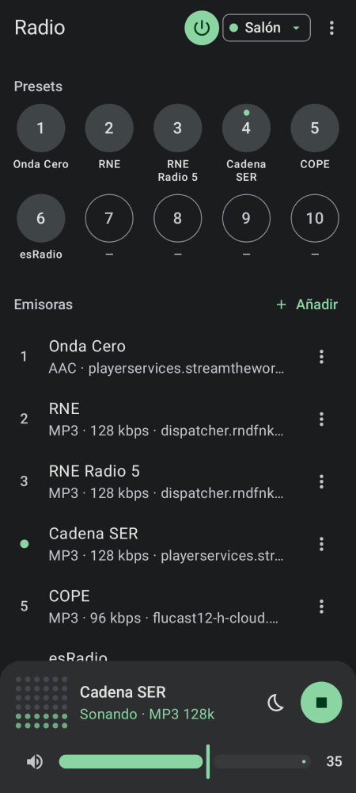
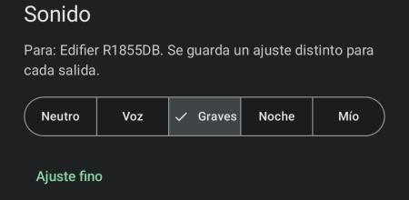
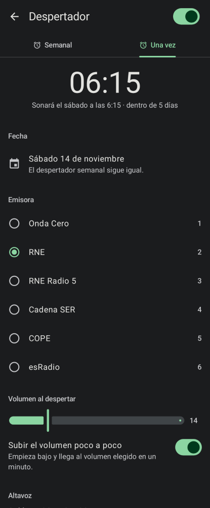

# SoundTouch Radio

*[Read in English](README.en.md)*

App Android libre (licencia MIT) para escuchar radio en un **Bose SoundTouch** por la Wi-Fi de casa, sin la nube de Bose (apagada el 6 de mayo de 2026), sin cuentas y sin servidores intermedios. También suena en **el propio móvil**, con auriculares o con altavoces Bluetooth.

| Radio | Este móvil | Sonido | Despertador | Buscar emisoras |
|---|---|---|---|---|
|  |  |  |  |  |

<sub>Capturas renderizadas con los componentes reales de la app y datos de ejemplo ([detalles](docs/capturas/LEEME.md)).</sub>

## Qué hace
- **Radio en el SoundTouch:** el altavoz descarga la emisora él solo; puedes cerrar la app y sigue sonando. La app solo da por buena una emisora cuando el altavoz confirma que suena.
- **10 presets** propios, emisoras precargadas (Onda Cero, RNE, RNE Radio 5, Cadena SER, COPE, esRadio) y **buscador** en el directorio abierto [radio-browser.info](https://www.radio-browser.info).
- **Emisoras https:** el SoundTouch no acepta direcciones https, pero sigue redirecciones; la app usa la versión http o un **puente de redirección** en el móvil (el audio no pasa por el móvil).
- **Este móvil:** la radio en el teléfono, por su altavoz, auriculares o Bluetooth, con **ecualizador** por salida. También con datos móviles.
- **Despertador** semanal y de «una vez», **temporizador** de apagado, **volumen fino** para la noche y controles en la pantalla de bloqueo.
- **Configurar la Wi-Fi** de un SoundTouch recién reseteado, sin la app de Bose.
- **Diagnóstico:** estado real del altavoz, registro de peticiones e informe para pedir ayuda sin datos personales.

## Instalar
- **APK:** descárgala de [Releases](../../releases) e instálala en el móvil (Android 8 o posterior). Detalles paso a paso en [INSTALAR.md](INSTALAR.md).
- **Compilar:** abre la carpeta en Android Studio, o desde la terminal: `./gradlew assembleDebug` (JDK 17). `./gradlew test` ejecuta las 118 pruebas, entre ellas un altavoz simulado.

## Qué está verificado
Con un **SoundTouch 10 (firmware 27.0.6)** y un **Pixel 10 (Android 17)**, sin cuenta de Bose:
- Vinculación, reproducción confirmada, pausa, volumen, encendido y reposo.
- Configuración de la Wi-Fi tras un reset de fábrica, sin la app de Bose.
- Emisoras https mediante redirección; siguen sonando con la app cerrada a la fuerza.
- «Este móvil» con Bluetooth y con datos móviles.

El resto, con su estado, está en **[COMPROBACIONES.md](COMPROBACIONES.md)**. Diseño: [DESIGN.md](DESIGN.md). Producto y reglas: [PRODUCT.md](PRODUCT.md).

## Modelos compatibles

La app usa la API local de Bose (puerto 8090) y el reproductor UPnP de los SoundTouch (puerto 8091). Según la documentación oficial de Bose («SoundTouch API WebServices»), esa API es común a toda la gama. Por eso la app no tiene nada atado a un modelo concreto, salvo los ejemplos de texto.

| Modelo | Estado |
|---|---|
| SoundTouch 10 (firmware 27.0.6) | **Verificado**: vinculación, reproducción, volumen, encendido, despertador, temporizador, buscador y configuración de la Wi-Fi tras un reset, sin cuenta de Bose. |
| SoundTouch 20, 30, 300, Portable, Wave, SA-5 | **Sin probar.** Deberían funcionar por compartir la API, pero nadie lo ha comprobado aún con esta app. |

**Asistente de la Wi-Fi con otros modelos:**
- La app busca cualquier red que empiece por «Bose». No la busca por el nombre exacto de la red del SoundTouch 10.
- La ayuda «¿Cómo se restablece mi modelo?» indica qué está verificado y qué sale de las instrucciones de Bose.
- Las redes de solo 5 GHz se descartan únicamente si la lista del propio altavoz no las incluye, no por el modelo.

**Si la usas con otro modelo,** cuenta cómo te va (modelo, firmware y qué funcionó). Las pruebas de `COMPROBACIONES.md` sirven de guía. Para compartir lo que respondió el altavoz, usa Diagnóstico → «Copiar informe», que oculta la MAC y la IP completas. Evita capturas de la ficha del altavoz.

## Emisoras precargadas (presets 1–6)

Todas son URLs **http** directas (sin HLS), elegidas en noviembre de 2026 a partir de radio-browser.info y comprobadas contra sus propios servidores, siempre que el entorno de desarrollo lo permitió.

| # | Emisora | URL | Evidencia |
|---|---|---|---|
| 1 | Onda Cero | `http://playerservices.streamtheworld.com/api/livestream-redirect/OCAAC.aac` | Montura `OCAAC` de Triton: redirección 302 comprobada. La señal oficial de Atresmedia es solo HLS por https, que el altavoz probablemente no admite. |
| 2 | RNE | `http://dispatcher.rndfnk.com/crtve/rne1/main/mp3/high` | El dispatcher responde (302 a MP3 128k). **Riesgo:** redirige a https con token. |
| 3 | RNE Radio 5 | `http://dispatcher.rndfnk.com/crtve/rne5/main/mp3/high` | Igual que RNE. |
| 4 | Cadena SER | `http://playerservices.streamtheworld.com/api/livestream-redirect/CADENASER.mp3` | 302 comprobado; radio-browser la verifica en http (MP3 128k). |
| 5 | COPE | `http://flucast12-h-cloud.flumotion.com/cope/net1.mp3` | `audio/mpeg`, 96 kbps comprobado; radio-browser OK en http. |
| 6 | esRadio | `http://livestreaming.esradio.fm/stream64.mp3` | radio-browser OK en http (MP3 56k). |

El móvil sigue las redirecciones y envía al altavoz la URL final si sigue siendo http. Las emisoras cambian de URL con el tiempo: si una deja de sonar, edítala o pruébala en el banco de pruebas.

## Arquitectura

```
┌──────────── Pixel (app) ─────────────┐            ┌──── SoundTouch 10 ────┐
│ UI Compose (Radio, Vincular, …)      │            │                       │
│        │ StateFlow                   │  HTTP 8090 │ API web (XML)         │
│ AppViewModel ── SpeakerController ───┼──────────► │ /info /now_playing    │
│        │        (máquina de estados) │  SOAP 8091 │ /volume /key …        │
│        │             │               ├──────────► │ UPnP AVTransport      │
│        │             │               │   WS 8080  │                       │
│        │             └ SoundTouchSocket◄──────────┤ notificaciones        │
│ StreamProbe (resuelve .pls/.m3u,     │            │        │ descarga     │
│   sonda MIME/icy, sigue redirecciones)            │        ▼              │
│ Discovery (SSDP + mDNS) · Linker     │            │  servidor de la radio │
│ Repos JSON (emisoras, altavoces,     │            └───────────────────────┘
│   ajustes y presets)                 │
└──────────────────────────────────────┘
```

| Paquete | Contenido |
|---|---|
| `soundtouch` | Cliente de la API 8090 (`SoundTouchApi`), parsers XML con `javax.xml` (probables en la JVM) y WebSocket. |
| `upnp` | Sobre SOAP, DIDL-Lite, descripción de dispositivo y `AvTransport`. |
| `playlist` | `UrlRules` (https, HLS, MIME), `PlaylistParser` (PLS/M3U, UTF-8/Latin-1) y `StreamProbe`. |
| `player` | `SpeakerController`, `Diagnosis` (lógica pura de confirmación y causa del fallo) y `RequestLog`. |
| `discovery` | `Ssdp`, `Discovery` (SSDP + NsdManager) y `Linker` (vinculación en 3 pasos). |
| `data` | Modelos, `JsonFile` (escritura atómica), repositorios, `StationCodec` (JSON/M3U/PLS) y `Seed`. |
| `ui` | Tema «Radio Braun», componentes (luz piloto, rejilla, tecla de preset) y pantallas. |

**Regla central:** «sonando» solo cuando `/now_playing` devuelve `source="UPNP"` con `PLAY_STATE`, en ≤15 s (con 10 s más si pasa por `BUFFERING_STATE`). Una respuesta SOAP correcta no se toma como prueba. Si no llega a sonar, la causa se diagnostica en este orden: https → HLS → nombre del altavoz → reposo → radio nativa activa → no confirmado.

## Protocolos (ejemplos)

```
GET http://IP:8090/now_playing
→ <nowPlaying deviceID="A0F6FD…" source="UPNP"><ContentItem source="UPNP" …/><playStatus>PLAY_STATE</playStatus></nowPlaying>

POST http://IP:8090/volume        <volume>35</volume>
POST http://IP:8090/key           <key state="press" sender="Gabbo">MUTE</key>  (y luego state="release")

POST http://IP:8091/AVTransport/Control
SOAPACTION: "urn:schemas-upnp-org:service:AVTransport:1#SetAVTransportURI"
<s:Envelope …><s:Body><u:SetAVTransportURI xmlns:u="urn:schemas-upnp-org:service:AVTransport:1">
  <InstanceID>0</InstanceID><CurrentURI>http://…/CADENASER.mp3</CurrentURI>
  <CurrentURIMetaData>&lt;DIDL-Lite …&gt;…object.item.audioItem.audioBroadcast…&lt;res protocolInfo="http-get:*:audio/mpeg:*"&gt;…</CurrentURIMetaData>
</u:SetAVTransportURI></s:Body></s:Envelope>
… después #Play con <Speed>1</Speed>.

Vinculación: GET /info  +  SOAP #GetTransportInfo (no hace sonar nada).
Descubrimiento: M-SEARCH ST=urn:schemas-upnp-org:device:MediaRenderer:1 · mDNS _soundtouch._tcp
```

## Privacidad y red

Sin analítica, anuncios, cuentas ni crash reporters, y sin fuentes ni imágenes remotas. El tráfico va solo al altavoz (LAN) y al servidor de la emisora que reproduces o compruebas. Se permite cleartext (`network_security_config`) porque el altavoz y los streams compatibles son http. El seguimiento del estado se detiene con la app en segundo plano.

**Android 17:** las apps que apuntan a la API 37 necesitan el permiso de ejecución `ACCESS_LOCAL_NETWORK` para hablar con la LAN. Esta app apunta a la API 35, así que en tu Pixel funciona sin pedirlo. Según la documentación oficial, con `targetSdk` inferior a 37 **no** hay que declararlo ni pedirlo (la versión 1.0.0 lo declaraba por error y eso bloqueaba la red local en Android 17; corregido en la 1.0.1). Al subir `targetSdk` a 37 habrá que declararlo y pedirlo en tiempo de ejecución antes de descubrir o vincular.

- **Puente de redirección (activado por defecto desde la 1.9.6; se desactiva en Ajustes):** mientras la app está abierta o arrancando una emisora, el móvil escucha en el puerto 8765 de tu red local. Solo responde redirecciones a las direcciones https de las emisoras que reproduces; cualquier otra petición recibe un 404. No sale nada a internet desde el móvil por este camino.

## Pruebas

```
./gradlew test            # 118 tests: parsers, SOAP/DIDL, listas, códec, diagnóstico, repositorios y altavoz simulado
./gradlew assembleDebug   # APK en app/build/outputs/apk/debug/
```

`FakeSpeakerTest` levanta un **altavoz simulado** (MockWebServer) que sirve `/info`, `/now_playing`, `/volume`, `AVTransport`, un stream, una redirección y una lista `.pls`. Reproduce los casos: sonar confirmado, cargar y luego sonar, SOAP correcto pero nunca suena (renderer bloqueado), reposo que no despierta, radio nativa que se traga la orden, `.pls` con la primera entrada caída, redirección seguida en el móvil y altavoz inalcanzable.

## Limitaciones conocidas
- Probada a fondo con **un** SoundTouch 10 (firmware 27.0.6) y un Pixel 10 (Android 17). Otros modelos y móviles: sin probar.
- Los botones físicos de preset del altavoz no se controlan: dependían de la nube de Bose ([informe](docs/INFORME-PRESETS-FISICOS.md)).
- El despertador y el temporizador del altavoz necesitan el móvil en casa, en la Wi-Fi, a esa hora.
- Las emisoras que solo emiten por https arrancan en el SoundTouch con el puente del móvil; si el altavoz reconecta más tarde, necesita el móvil en casa.
- Multiroom experimental y sin verificar con UPnP.
- Interfaz en español e inglés: sigue el idioma del móvil y, en Android 13 o posterior, se elige en Ajustes → Idioma. Para otra traducción, añade `res/values-xx/strings.xml`.

## Informes
- [Botones físicos de preset](docs/INFORME-PRESETS-FISICOS.md): no viable solo con la app; opciones y riesgos.
- [Temporizador de apagado](docs/INFORME-TEMPORIZADOR.md): implementado en la 1.1.0 según este diseño.
- **Despertador (1.3.0):** viable desde el móvil, con dos condiciones: el móvil en casa y en la Wi-Fi a esa hora, y que el altavoz responda en red tras horas en reposo (COMPROBACIONES 32 y 34). Usa `setAlarmClock` (exacta, sin retrasos por Doze) con `USE_EXACT_ALARM`; si la radio no confirma que suena, notificación con sonido de alarma en el móvil.

## Contribuir
¿La usas con otro modelo de SoundTouch u otro móvil? Abre un [issue](../../issues/new/choose) con la plantilla «Otro modelo»: modelo, firmware y qué funcionó. Para fallos, pega el texto de Diagnóstico → **Copiar informe** (oculta la MAC y la IP). Más en [CONTRIBUTING.md](CONTRIBUTING.md). Historial de versiones: [CHANGELOG.md](CHANGELOG.md).

No está afiliada a Bose Corporation. «Bose» y «SoundTouch» son marcas de sus propietarios.

## Licencia
MIT. Ver [LICENSE](LICENSE). No está afiliado a Bose Corporation.
