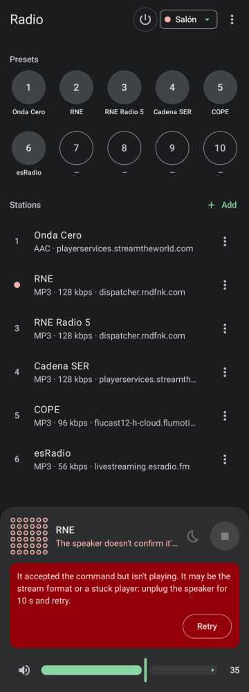
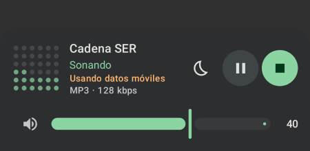
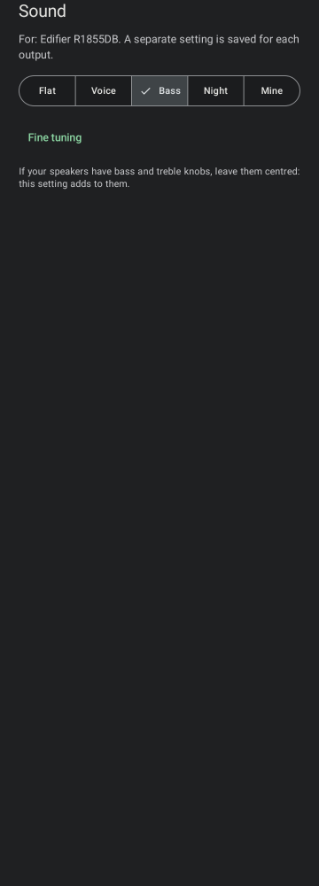
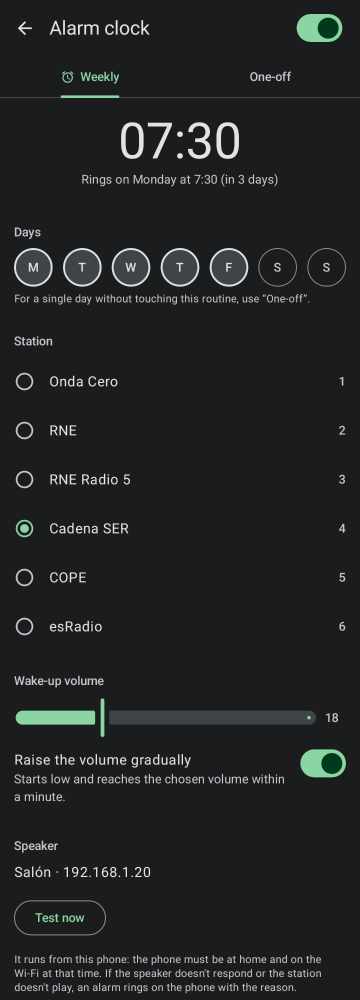
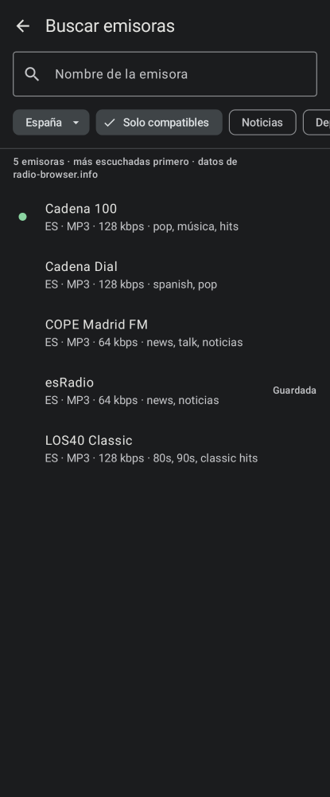

# SoundTouch Radio

*[Leer en español](README.es.md)*

Free Android app (MIT licence) to play internet radio on a **Bose SoundTouch** over your home Wi-Fi, without the Bose cloud (shut down on 6 May 2026), no accounts and no intermediate servers. It also plays on **the phone itself**, on headphones or on Bluetooth speakers.

| Radio | This phone | Sound | Alarm clock | Station search |
|---|---|---|---|---|
|  |  |  |  |  |

Screenshots rendered from the app's real components with sample data (the "This phone" and search screenshots are from the Spanish UI). The app is available in **Spanish and English**: it follows the phone's language, and on Android 13+ you can pick it in Settings → Language.

## Features
- **Radio on the SoundTouch:** the speaker streams the station by itself; you can close the app and it keeps playing. A station only counts as playing once the speaker confirms it.
- **10 presets** of its own, preloaded Spanish stations (Onda Cero, RNE, RNE Radio 5, Cadena SER, COPE, esRadio) and **search** in the open directory [radio-browser.info](https://www.radio-browser.info).
- **HTTPS stations:** SoundTouch rejects HTTPS URLs sent directly, but it follows redirects. The app uses the station's HTTP version or a **redirect bridge** on the phone (audio does not go through the phone).
- **This phone:** play on the phone, headphones or Bluetooth, with a per-output **equalizer**. Also on mobile data.
- Weekly and one-off **alarm clock**, **sleep timer**, fine **low-volume control** for night use and lock-screen controls.
- **Wi-Fi setup** of a factory-reset SoundTouch, without the Bose app.
- **Diagnostics:** real speaker state, request log and a shareable report without personal data.

## Install
- **APK:** download it from [Releases](../../releases) and install it (Android 8 or later). Step-by-step guide (Spanish): [INSTALAR.md](INSTALAR.md).
- **Build:** open the folder in Android Studio, or run `./gradlew assembleDebug` (JDK 17). `./gradlew test` runs the 118 tests, including a simulated speaker.

## What has been verified
With a **SoundTouch 10 (firmware 27.0.6)** and a **Pixel 10 (Android 17)**, without a Bose account:
- linking, confirmed playback, pause, volume, power on and standby;
- Wi-Fi setup after a factory reset, without the Bose app;
- HTTPS stations via redirect, still playing after force-closing the app;
- "This phone" over Bluetooth and on mobile data.

Other SoundTouch models share the same local API (Bose "SoundTouch API WebServices") and should work, but they are untested. Full manual checklist (Spanish): [COMPROBACIONES.md](COMPROBACIONES.md).

## Privacy
No analytics, ads, accounts or remote crash reporting. The app only talks to your speaker on the local network, to the station's server and, when you search, to radio-browser.info. The redirect bridge listens on port 8765 of your local Wi-Fi and only answers redirects to the stations you play.

## Contributing
Using it with another SoundTouch model or phone? Open an [issue](../../issues/new/choose) with the "Otro modelo" (other model) template. For bugs, paste the text from Diagnóstico → **Copiar informe** (it hides your MAC and IP). Translations are welcome: Spanish strings live in `app/src/main/res/values/strings.xml`, English in `values-en/`; add `values-xx/strings.xml` for another language. See [CONTRIBUTING.md](CONTRIBUTING.md) (Spanish) and [CHANGELOG.md](CHANGELOG.md) (Spanish).

Not affiliated with Bose Corporation. "Bose" and "SoundTouch" are trademarks of their respective owners.

## Licence
MIT. See [LICENSE](LICENSE).
